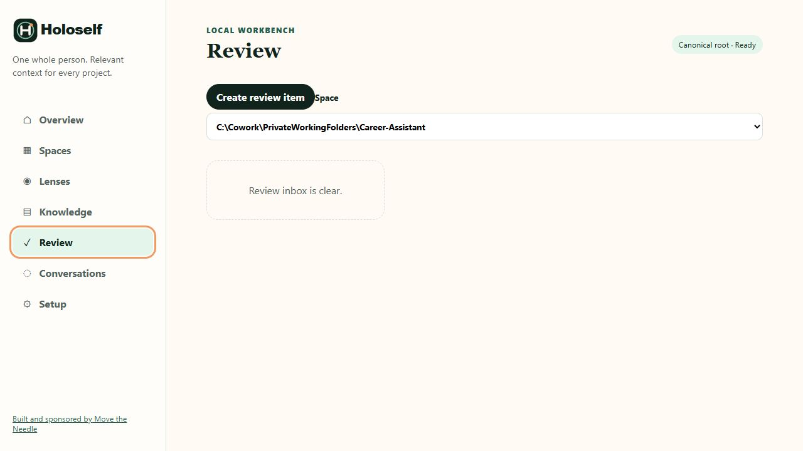

# Review

Review is the human approval boundary between project-owned evidence and reusable canonical self knowledge. A model or connector can create a pending proposal, but it cannot approve its own durable change.

The real inbox in the screenshot is clear. That is a valid state: it means the selected Space has no pending or invalid proposal items, not that proposal review is disabled.

## Read the inbox

The Review inbox (`GET /api/inbox?space=all|<space_id>&limit=<n>&offset=<n>`) aggregates pending proposals across all cataloged linked spaces—or filters to a single cataloged space by `space_id` (or name)—without exposing absolute filesystem paths. Responses are bounded (default 200 items with `truncated`, `total`, `limit`, `offset`, and `next_offset`) and groups reference item IDs (`item_ids`) keyed by `space_id`.

- **Near-duplicate grouping (`duplicate_group`)**: Proposals whose normalized claim text reaches a complete-linkage token similarity of at least `0.72` with every member of the cluster are grouped together under a deterministic `dup-<hash>` group with a **Near-duplicate** badge and a **Select group** checkbox.
- **Conflict hints (`conflict_hints`)**: Each item returns up to the top 3 conflict hints by score (with short excerpts `<= 200` characters), flagging contradictions against existing current claims in the target document (using `contradictionDigest` and the metric-difference heuristic) as well as competing pending operations that target the same `claim_id` (such as a pending `supersede_claim` and `retire_claim` on the same claim).
- **Visibility-change badge (`visibility_change`)**: Proposals that change a claim's visibility display `visibility <from> → <to>`.
- **Expandable lazy preview**: Expand **Preview exact changes** on any item to fetch its exact diff and `previewHash` on demand via `POST /api/proposals/<id>/preview`.
- **Audit findings**: Unmanaged or malformed proposal files appear as **Needs adoption or repair** with a diagnostic code and suggested action.

## Create a pending item manually

**Create review item** asks for:

- the proposed claim;
- a project-owned source file containing evidence;
- the canonical target, defaulting to `context/claims.md`.

Creating the item writes only a pending proposal inside the selected project's `.holoself/proposals/`. It does not update canonical self.

## Make a decision

1. Open **Review decision**.
2. Verify the target document, source evidence, exact knowledge to add, and affected files.
3. Choose one action:
   - **Approve exact change** applies only the previewed hash-bound change;
   - **Defer** keeps the item pending for later consideration;
   - **Reject** records that the proposal should not be adopted;
   - **Supersede** records that a newer proposal or evidence replaces it.
4. Confirm the decision and re-check the inbox.

If the preview changed after you opened it, approval fails as stale. Re-open the proposal and review the new exact change; never bypass the hash check.

## Batch review actions

Select multiple inbox items (individually, per group with **Select group**, or across the view with **Select all**) and choose **Approve selected**, **Defer selected**, or **Reject selected** (`POST /api/inbox/batch`, capped at 50 items per batch):

- Every item in a batch approval still requires its own fresh `preview_hash`. If any item's preview is stale, the entire batch is refused (`STALE_PREVIEW`, HTTP 409) before any file is written.
- Batch approval is all-or-nothing under a single `withRegistryLock`: changes compose deterministically in batch order, and any write, conflict, or post-approval validation failure rolls back every target file, proposal record, archive, and receipt across the batch.
- One receipt (`proposals/receipts/<proposal_id>-<decision>.json`) is written per proposal. Batches mixing spaces from different canonical self roots are refused (`MIXED_SELF_ROOTS`).

[Next: Conversations](conversations.md) · [Back to the Workbench tour](index.md)
